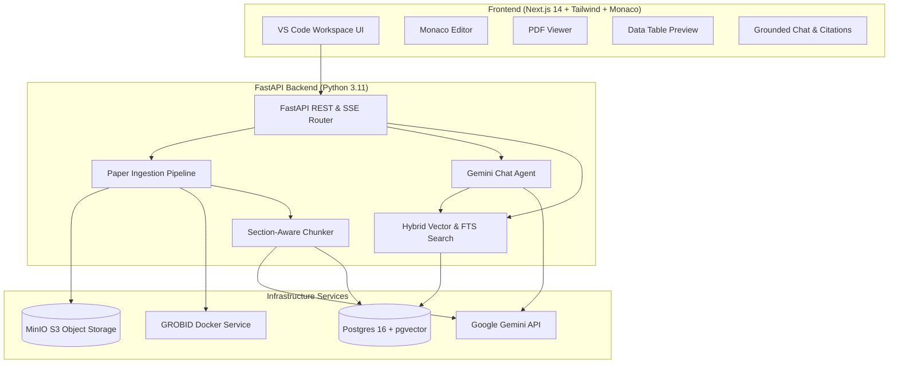

# ResearchIDE 🔬

> An IDE-style workspace for academic research. Manage your research library, data stores, and drafts with an AI research agent powered by the **Gemini API** that strictly answers questions pulling information **ONLY** from your project's materials, with clickable citations.

---

## 🌟 Key Features

### 🖥️ VS Code-Style Academic IDE Layout
- **Left Sidebar (Project File Tree)**:
  - `/library`: Academic papers (PDFs, metadata, sections, DOI/arXiv links).
  - `/data`: Datasets (CSV, Parquet, TSV) with row counts and column schemas.
  - `/drafts`: Theses, papers, and notes (LaTeX, Markdown, Python, Typst).
- **Center (Tabbed Editor & Split View)**:
  - **Monaco Editor**: High-performance editor for LaTeX (`.tex`) and Markdown (`.md`) with syntax highlighting, statistics, and debounced autosave.
  - **PDF Viewer**: Academic paper viewer with table of contents and direct section jump.
  - **Data Table Preview**: Sortable, filterable, and paginated table preview for CSV & Parquet datasets.
  - **Split View**: Side-by-side comparison (e.g. read two papers side-by-side, or write a thesis draft next to a reference paper).
- **Right Panel (Grounded AI Chat)**:
  - Powered by **Gemini 2.0 / 1.5** with function calling.
  - **Strict Grounding Policy**: Only answers using project papers and data stores; refuses ungrounded speculation.
  - **Interactive Citations**: Clickable badges (`[Paper, Section, p. X]`) that immediately open the source paper tab and navigate to the referenced section.
- **Top Bar & Quick Switcher**:
  - Project repo switcher and creation modal.
  - Global Search modal (`Cmd+P` / `Ctrl+P`) with hybrid semantic + keyword search.

---

## 🏛️ System Architecture



---

## 🛠️ Tech Stack

| Layer | Technology |
|---|---|
| **Frontend** | Next.js 14 (App Router), TypeScript, Tailwind CSS, shadcn/ui, Monaco Editor, Lucide Icons |
| **Backend** | FastAPI (Python 3.11), SQLAlchemy (Async), Pydantic v2, Tiktoken |
| **Vector DB** | PostgreSQL 16 with **pgvector** (HNSW cosine similarity & full-text search) |
| **File Storage** | MinIO (S3-compatible bucket storage for PDFs and datasets) |
| **PDF Extraction** | GROBID (TEI-XML parsing) + PyMuPDF / Fallback Parser |
| **AI / LLM** | Google Gemini API (`gemini-2.0-flash` / `gemini-1.5-pro` & `text-embedding-004`) |
| **Containerization** | Docker Compose |

---

## 🚀 Quickstart (Local Docker Setup)

### 1. Clone the repository
```bash
git clone https://github.com/rynxnet/HackPSU-2026.git
cd HackPSU-2026
```

### 2. Configure Environment Variables
Copy the example environment file:
```bash
cp .env.example .env
```
Edit `.env` and insert your **Google Gemini API Key**:
```env
GEMINI_API_KEY=your_actual_gemini_api_key_here
```

### 3. Launch Services with Docker Compose
```bash
docker compose up --build
```

Services will initialize on:
- **Frontend Workspace**: [http://localhost:3000](http://localhost:3000)
- **FastAPI Documentation**: [http://localhost:8000/docs](http://localhost:8000/docs)
- **MinIO S3 Console**: [http://localhost:9001](http://localhost:9001) (`minioadmin` / `minioadmin`)
- **GROBID TEI Service**: [http://localhost:8070](http://localhost:8070)
- **Postgres + pgvector**: `localhost:5432`

### 4. (Optional) Seed Demo Data
To preload a demo project with papers (*Attention Is All You Need*), quantum benchmark datasets, and sample drafts:
```bash
docker compose exec backend python scripts/seed_demo.py
```

---

## ⌨️ Keyboard Shortcuts

| Shortcut | Action |
|---|---|
| `Cmd+P` / `Ctrl+P` | Open Global Search (keyword + semantic search across papers, datasets & drafts) |
| `Cmd+K` / `Ctrl+K` | Focus AI Research Chat input |
| `Cmd+\` / `Ctrl+\` | Toggle Split View (open documents side-by-side) |
| `Cmd+B` / `Ctrl+B` | Toggle Left Explorer Sidebar |
| `Enter` (in chat) | Send message to Gemini research agent |
| `Shift+Enter` | Newline in chat input |

---

## 📑 API Endpoints Summary

### Projects & Explorer
- `GET /api/v1/projects`: List user's research repositories
- `POST /api/v1/projects`: Create new research repository
- `GET /api/v1/projects/{id}/tree`: Get hierarchical file tree (`/library`, `/data`, `/drafts`)

### Library Ingestion (/library)
- `POST /api/v1/projects/{id}/papers/upload`: Bulk drag & drop upload of academic PDFs
- `POST /api/v1/projects/{id}/papers/import-doi`: Automatic import and download via DOI / arXiv identifier
- `GET /api/v1/papers/{id}`: Detailed paper metadata, abstract, and extracted sections
- `GET /api/v1/papers/{id}/pdf`: Stream PDF for in-browser viewer

### Datasets (/data)
- `POST /api/v1/projects/{id}/datasets/upload`: Upload CSV / Parquet datasets
- `GET /api/v1/datasets/{id}/preview`: Paginated and sortable row preview

### Drafts (/drafts)
- `POST /api/v1/projects/{id}/drafts`: Create thesis chapter, LaTeX draft, or markdown notes
- `PUT /api/v1/drafts/{id}`: Autosave draft content and versioning

### Grounded AI Chat & Retrieval
- `POST /api/v1/projects/{id}/chat/message`: Grounded Q&A turn with inline citations
- `POST /api/v1/projects/{id}/chat/stream`: Server-Sent Events (SSE) token stream with citations payload
- `GET /api/v1/projects/{id}/search`: Hybrid semantic + full-text search across all project materials

---

## 🔒 Grounding & Citation Policy
The AI Chat Agent runs with strict system instructions:
1. Answers are constructed **strictly and only** using the project's vector chunks and dataset schemas.
2. If evidence is missing from the project, the agent explicitly states that the library does not contain sufficient information.
3. Every factual assertion includes an interactive citation badge linking directly to the specific page and section of the paper.
