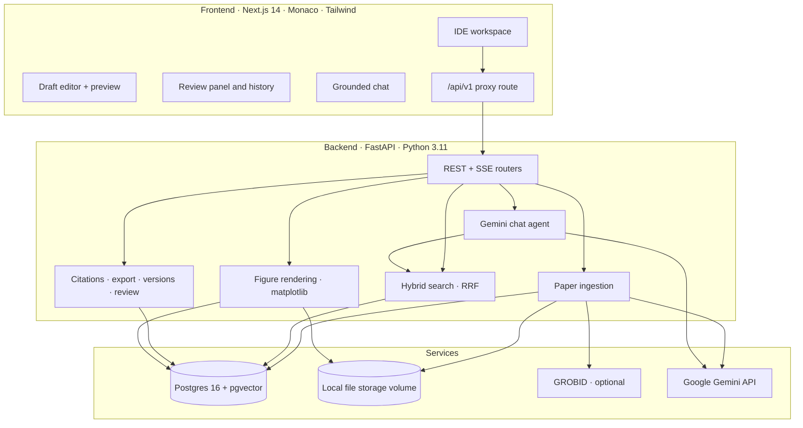

# ResearchIDE 🔬

**An IDE for academic research that connects your papers, data, drafts and reviews in one workspace, so you stop copying things between tools by hand.**

Researchers already have good tools for each step: reference managers, notebooks, Overleaf, Word. The time goes into the *glue* between them: copying a quote and its citation into a draft, exporting a plot and re-uploading it after every data change, reformatting a paper for a different journal, and juggling reviewer comments against manuscript versions. ResearchIDE keeps all of it in one project and does the glue for you, with an AI research assistant that answers **only** from your own papers and cites the page it used.

---

## Why this exists

| Pain point | What the research says | What ResearchIDE does |
|---|---|---|
| **Formatting & resubmission** | A median of 14 hours to format one manuscript, about 52 hours per researcher per year (LeBlanc et al., *PLOS ONE*, 2019). | One-click export to IEEE, ACM, APA or a generic article. |
| **Lost lineage between data and figures** | Over half of researchers have failed to reproduce *their own* results; untracked scripts, data and figure versions are a leading cause (*Nature* reproducibility survey, 2016). | Figures are generated from datasets and stay linked. Replace the data and every figure re-renders, all the way into the export. |
| **Reading → writing friction** | Reference managers store metadata well but don't connect a claim in Paper A to your draft without copy-paste (ACM CHI studies of synthesis workflows). | Quote a passage or an AI answer straight into the draft, with a proper citation key and page. |
| **Tool juggling** | Researchers commonly run 5–8 separate apps for writing, analysis, references, notes and review. | Library, data, drafts, AI chat, version history and peer review live in one project. |

---

## ✨ Features

### Workspace
- **VS Code-style layout:** an explorer with `/library` (papers), `/data` (datasets), `/drafts` (Markdown / LaTeX) and `/figures`; tabbed editors with split view; global search (`Ctrl/Cmd+P`).
- **Paper library:** drag-and-drop PDF upload or import by DOI / arXiv ID. Metadata is fetched automatically, and papers are parsed into sections, chunked and embedded for search. There's an in-browser PDF viewer plus an *Extracted Sections* reader.
- **Datasets:** CSV, TSV and Parquet with schema detection, summary statistics, and a sortable, filterable, paginated table.
- **Drafts:** a Monaco editor for Markdown and LaTeX with autosave, word counts and syntax highlighting.

### Grounded AI research chat
- Answers come **only** from your project's papers and datasets, via hybrid retrieval (pgvector cosine similarity + Postgres full-text search, fused with reciprocal rank fusion). If the library doesn't contain the evidence, it says so.
- Every claim carries a clickable citation that opens the paper at the right section and page.
- Answers stream in token by token, and follow-up questions keep the conversation's context.
- Powered by Google Gemini, with automatic fallback across models when one hits its free-tier quota.

### 1. Reading → Writing: cite without copy-paste
- **Cite / Quote buttons** on every citation the AI gives you.
- **Insert into draft** on any AI answer: its inline citations are converted to real citation keys, e.g. `[Attention Is All You Need, Introduction, p. 2]` → `[@vaswani2017attention, p. 2]`.
- **Quote from the paper reader:** select any passage in *Extracted Sections* and click **Quote in draft**.
- **Autocomplete:** type `[@` in Markdown or `\cite{` in LaTeX to pick from your library.
- **Automatic bibliography:** stable, Google-Scholar-style keys (`vaswani2017attention`), BibTeX and APA references generated from paper metadata. Download `references.bib` any time.
- Inserts go to the most recently used draft at your cursor, even when that tab isn't visible.

### 2. Draft → Journal: one-click re-templating
- **Export** a draft as an Overleaf-ready `.zip` containing `main.tex`, `references.bib` and `figures/`:

  | Template | Class / bibliography style |
  |---|---|
  | Generic article | `article` + natbib (`plainnat`) |
  | IEEE conference | `IEEEtran` + `IEEEtran.bst` |
  | ACM (sigconf) | `acmart` + `ACM-Reference-Format` |
  | APA-style manuscript | `article`, double-spaced 12pt + `apacite` |
  | Markdown + references | `(Author, Year)` citations and a formatted reference list |

- **Markdown drafts** are converted to LaTeX: headings, emphasis, lists, quotes, math, code, links, `[@key, p. N]` → `\cite[p.~N]{key}`, figures → `figure` environments, `@fig:label` → `Figure~\ref{fig:label}`. An *Abstract* section is placed where each template expects it.
- **LaTeX drafts** are re-templated: the preamble is replaced and your body text is kept.
- **Live preview:** a side-by-side manuscript view with formatted citations, numbered figures, rendered math and a generated reference list.
- All four LaTeX templates are verified to compile with `pdflatex` + `bibtex` with no undefined references.

### 3. Draft ↔ Peer review
- **Version history:** checkpoints are saved automatically while you write (at most every 5 minutes), and you can save named versions ("Submitted to ACL"). Compare any version with the current draft side by side; restoring first saves your current text, so it can always be undone.
- **Review panel:** paste a whole decision letter and it is split into comments by reviewer and numbered point. A passage the reviewer quoted becomes a clickable anchor that jumps to it in your draft. For each comment you can:
  - track its status: *open*, *addressed* or *declined*;
  - write a response, or have the AI draft one from your manuscript.

  **Download response letter** produces a formatted, point-by-point *Response to Reviewers* document.

### 4. Data → Paper: live, linked figures
- **Create figure** from any dataset: line, bar, scatter or histogram, rendered as a 300 dpi publication-style PNG.
- Insert it with one click: `` in Markdown, or a `figure` environment in LaTeX.
- **Replace data** on a dataset: every figure built from it re-renders automatically, in the preview and in every export.

---

## 🎬 Five-minute demo

1. **New project:** use the project switcher (top left) → *Create New Project*.
2. **Import a paper:** click **Import DOI** and enter `arXiv:1706.03762` (*Attention Is All You Need*).
3. **Ask the AI:** "What is multi-head attention?" The answer streams in with page-level citations; click one to open the paper there.
4. **Write:** open `notes.md` and click **Insert into notes.md** under the answer. Type `[@` to autocomplete another citation, then toggle **Preview**.
5. **Add data:** upload a small CSV, e.g. `model,bleu` with a few rows, open it, click **Create figure**, then **Insert into draft**.
6. **Change the data:** click **Replace data** with an updated CSV and watch the figure update in the preview.
7. **Get reviewed:** in the draft, click **Review** → **Paste review**, paste a few numbered comments, and try **Draft a response with AI** and the response-letter download.
8. **Submit:** click **Export** → *IEEE conference*, and upload the zip to Overleaf (*New Project → Upload Project*).

---

## 🏛️ Architecture



- The browser only talks to the Next.js server, which proxies `/api/v1/*` to the backend inside Docker (`frontend/src/app/api/v1/[...path]/route.ts`).
- PDFs, datasets and figures are stored in a Docker volume (`STORAGE_BACKEND=local`). S3 / MinIO is supported via `STORAGE_BACKEND=s3`, but it isn't part of the default compose file.
- Paper parsing uses **GROBID** when it's running and falls back to **PyMuPDF** otherwise.

## 🛠️ Tech stack

| Layer | Technology |
|---|---|
| Frontend | Next.js 14 (App Router), TypeScript, Tailwind CSS, shadcn/ui, Monaco Editor (+ diff editor), Zustand, react-markdown + KaTeX |
| Backend | FastAPI, SQLAlchemy 2 (async), Pydantic v2, pandas, matplotlib, PyMuPDF, tiktoken |
| Database | PostgreSQL 16 + pgvector (HNSW cosine index) + full-text search |
| AI | Google Gemini: `gemini-3.5-flash` for chat (with fallbacks), `gemini-embedding-001` for 768-dim embeddings |
| Infra | Docker Compose; optional GROBID 0.8.1 |

---

## 🚀 Quickstart

**Prerequisites:** Docker Desktop and a [Gemini API key](https://aistudio.google.com/apikey).

```bash
git clone https://github.com/rynxnet/HackPSU-2026.git
```

```bash
cd HackPSU-2026
```

```bash
cp .env.example .env
```

Edit `.env` and set your key:

```env
GEMINI_API_KEY=your_key_here
```

Build and start everything:

```bash
docker compose up -d --build
```

Open **http://localhost:3000**. The API docs are at http://localhost:8000/docs.

| Service | Address |
|---|---|
| Frontend | http://localhost:3000 |
| Backend API / Swagger | http://localhost:8000/docs |
| Postgres + pgvector | `localhost:5432` (`postgres` / `postgres`) |
| GROBID (optional) | http://localhost:8070 |

**Optional: better paper parsing with GROBID**

```bash
docker compose --profile grobid up -d --build
```

**Day to day**
- Code edits hot-reload in both containers, so there's no need to rebuild.
- Rebuild only after changing `requirements.txt`, `package.json` or a Dockerfile:

  ```bash
  docker compose up -d --build
  ```

  After changing `frontend/package.json`, add `-V`, because the frontend keeps `node_modules` in its own volume.
- To stop everything: `docker compose down`. Adding `-v` also **deletes** the database and uploaded files.

**Platform notes**
- **Windows / macOS:** Docker doesn't forward file-change events into bind mounts, so the frontend runs with `WATCHPACK_POLLING=true` (already set in `docker-compose.yml`).
- **macOS:** if you see `mkdir /host_mnt/Users/...: operation not permitted`, macOS is blocking Docker from the folder. Grant Docker access to *Documents* (System Settings → Privacy & Security → Files and Folders) or move the repo out of `~/Documents`.

---

## ⚙️ Configuration

All settings live in `.env` (see `.env.example`) and have defaults in `backend/app/config.py`.

| Variable | Default | Notes |
|---|---|---|
| `GEMINI_API_KEY` | none | Required for live answers. Without it, chat returns a deterministic offline excerpt and embeddings use a hash-based fallback. |
| `GEMINI_CHAT_MODEL` | `gemini-3.5-flash` | Primary chat model. |
| `GEMINI_FALLBACK_MODELS` | `gemini-3.5-flash-lite,gemini-3.1-flash-lite,gemini-flash-lite-latest,gemini-flash-latest` | Tried in order when a model is out of quota or busy. |
| `GEMINI_EMBEDDING_MODEL` | `gemini-embedding-001` | Truncated to 768 dimensions to match the database column. |

**Gemini free tier:** about 20 requests per model per day. The fallback list stretches that to roughly 100 chats a day; if every model is exhausted, chat says so instead of hanging. For a live demo, a key with billing enabled removes the limit. Embeddings have their own quota: if it runs out, uploaded papers still work but fall back to hash embeddings, which weakens semantic search.

---

## ⌨️ Shortcuts & syntax

| Shortcut | Action |
|---|---|
| `Ctrl/Cmd+P` | Global search across papers, datasets and drafts |
| `Ctrl/Cmd+K` | Focus the AI chat |
| `Ctrl/Cmd+\` | Toggle split view |
| `Ctrl/Cmd+B` | Toggle the explorer |
| `Enter` / `Shift+Enter` | Send / newline in chat |

| In a draft | Markdown | LaTeX |
|---|---|---|
| Cite | `[@vaswani2017attention]` | `\cite{vaswani2017attention}` |
| Cite with page | `[@vaswani2017attention, p. 3]` | `\cite[p.~3]{vaswani2017attention}` |
| Several sources | `[@a; @b]` | `\cite{a,b}` |
| Figure | `` | `\includegraphics{figures/bleu-by-model.png}` in a `figure` env |
| Refer to a figure | `@fig:bleu-by-model` | `\ref{fig:bleu-by-model}` |

---

## 📑 API overview

All routes are under `/api/v1`. Full interactive docs are at `/docs`.

| Area | Endpoints |
|---|---|
| Auth | `POST /auth/register`, `POST /auth/login`, `GET /auth/me`, `POST /auth/logout` |
| Projects | `GET/POST /projects`, `GET/DELETE /projects/{id}`, `GET /projects/{id}/tree` |
| Papers | `POST /projects/{id}/papers/upload`, `POST /projects/{id}/papers/import-doi`, `GET/DELETE /papers/{id}`, `GET /papers/{id}/pdf` |
| Datasets | `POST /projects/{id}/datasets/upload`, `GET/DELETE /datasets/{id}`, `GET /datasets/{id}/preview`, `POST /datasets/{id}/replace` |
| Drafts | `GET/POST /projects/{id}/drafts`, `GET/PUT/DELETE /drafts/{id}` |
| Bibliography | `GET /projects/{id}/bibliography`, `GET /projects/{id}/bibliography.bib` |
| Export | `GET /export/templates`, `POST /drafts/{id}/export` |
| Versions | `GET/POST /drafts/{id}/versions`, `GET /draft-versions/{id}`, `POST /draft-versions/{id}/restore` |
| Peer review | `GET/POST /drafts/{id}/comments`, `POST /drafts/{id}/comments/import`, `PATCH/DELETE /review-comments/{id}`, `POST /review-comments/{id}/suggest`, `GET /drafts/{id}/response-letter` |
| Figures | `GET /projects/{id}/figures`, `POST /datasets/{id}/figures`, `GET/PATCH/DELETE /figures/{id}`, `GET /figures/{id}/image` |
| Chat & search | `GET/POST /projects/{id}/chat/sessions`, `GET /chat/sessions/{id}`, `POST /projects/{id}/chat/message`, `POST /projects/{id}/chat/stream` (SSE), `GET /projects/{id}/search` |

---

## 📂 Project layout

```
backend/
  app/
    models/      SQLAlchemy models (papers, datasets, drafts, chat, figures, versions, reviews)
    routers/     FastAPI routes
    services/    ingestion, search, Gemini agent, citations, export, figures, draft history
    schemas/     Pydantic request / response models
  scripts/init_db.sql   pgvector extension and base schema
frontend/
  src/app/              Next.js pages and the /api/v1 proxy route
  src/components/       editor, chat, layout and modal components
  src/lib/              API client, types, citation helpers
  src/store/            Zustand workspace store
docker-compose.yml
```

---

## 🔒 Grounding policy

1. Answers are built **only** from the project's indexed paper chunks and dataset schemas.
2. If the project lacks the evidence, the agent says so instead of speculating.
3. Every factual statement carries a citation to a specific paper, section and page.

## ⚠️ Known limitations

- **Single-user demo auth:** requests without a login token act as the oldest account, and CORS allows any origin. Turn both off before exposing the app beyond your machine.
- **Paper parsing:** without GROBID, the PyMuPDF fallback can produce rough section titles. Run the `grobid` profile for cleaner sections.
- **Not built yet:** a literature-matrix view (extracting a comparison table across papers) is the natural next feature.
- **SDK deprecation:** the backend uses the deprecated `google-generativeai` SDK; migrating to `google-genai` is planned.
