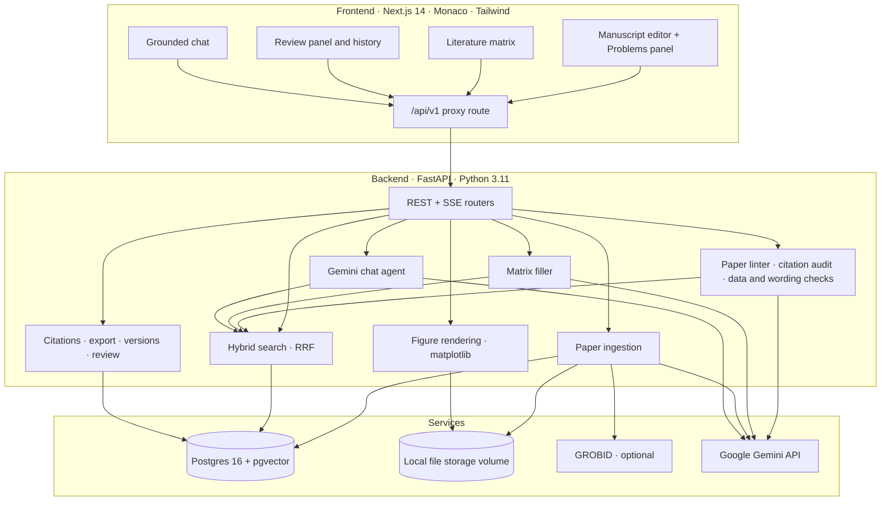

# ResearchIDE 🔬

**An IDE for writing research papers: it finds the problems in your paper before reviewers do.**

ResearchIDE checks what you wrote against your sources and your data, the way a code editor underlines bugs: claims your citations don't support, papers cited for something they never said, numbers that disagree with your results spreadsheet, and sentences copied from a source without quotation marks. It also turns a stack of papers into a comparison table with every cell traced to the page it came from, then carries that, along with your citations, figures and reviewer comments, through to a journal-ready LaTeX submission.

> Other tools help you **read** papers. ResearchIDE helps you **write** them, and checks that what you wrote is true.

---

## 🧭 What makes it different

Tools like NotebookLM, Elicit and SciSpace are excellent at *answering questions about your sources*. ResearchIDE has that too (grounded chat with page-level citations), but its focus is the part those tools don't cover: **your manuscript**.

| | Chat-over-documents tools | ResearchIDE |
|---|---|---|
| Ask questions about your papers | ✅ | ✅ |
| Check **your draft's claims** against the sources you cited | ❌ | ✅ Citation audit |
| Catch numbers in the text that **disagree with your data** | ❌ | ✅ Data check |
| Flag wording **copied from a source** without quotes | ❌ | ✅ Copied-wording check |
| Turn papers into a **structured, page-traced table** you can chart | Prose summaries | ✅ Literature matrix |
| Export a formatted, cited **submission** (IEEE / ACM / APA) | ❌ | ✅ |
| Track **peer review** and draft a response letter | ❌ | ✅ |

---

## ✨ Headline features

### 🩺 Problems panel: a linter for your paper
Opening a project lands you in your manuscript, not a chat window. Problems are underlined right in the text, compiler-style, with a hover explanation, and listed in a **Problems** panel under the editor:

> **paper.md:** ❌ 2 errors · ⚠️ 3 warnings · ℹ️ 2 suggestions · 11/14 claims verified

- **Click** a problem to jump to it; **one-click fixes** apply the suggested change ("Use 28.4", "Cite Devlin et al., 2018 instead").
- The instant checks re-run automatically a moment after each autosave.
- A toolbar badge shows the paper's health at a glance; chat is a side tool you open when you need it.

### 🔎 Citation audit
Click **Audit citations** and every claim in the draft is checked against **the paper it cites** and **the rest of your library**. Each claim is classified as:

| Verdict | Meaning | Suggested fix |
|---|---|---|
| ✅ Supported | The cited paper says this | None needed |
| ⚠️ Cited source doesn't say this | The support is in a *different* paper | Swap in the right citation and page |
| ⚠️ Overstated | The source supports only part of the claim (a number, scope or strength) | Shown with the source passage |
| ❌ Unsupported | Nothing cited (or in the library) backs it | Add a source or rephrase as your own finding |
| ℹ️ Needs a citation | A factual claim with no citation, which your library supports | Insert the citation |

The audit sees each claim's supporting passage, and you can open the source at that page. It costs one AI request per run, and results are cached until you re-run it; edited sentences drop out automatically.

### 📊 Data and wording checks (instant, no AI)
- **Numbers vs. your data:** "transformer-big reaches 28.1 BLEU" is flagged when `results.csv` says 28.4. Each number is paired with the row (model, condition, …) named before it in the sentence, so a sentence comparing two models is checked correctly.
- **Copied wording:** a sentence that repeats 10+ consecutive words from a paper in your library, without quotation marks, is flagged with the source passage and a one-click citation.
- **Broken references:** citation keys that don't exist ("did you mean @vaswani2017attention?"), and references to figures that don't exist.
- **Open reviewer comments** still waiting for a response.

### 🧮 Literature matrix: papers → page-traced data
Pick the questions (*approach, benchmark, models used, success rate, human in the loop?, key limitation…*, or your own) and ResearchIDE fills a table with **one row per paper**, read from each paper's own text in the background.
- **Every cell links to its evidence:** click it to see the exact passage and page, and open the paper there.
- **Correct any cell;** your edits are never overwritten by later fills.
- Columns can be **text, number or yes/no**, and you can add a column at any time.
- **Save as dataset** turns the matrix into a CSV in `/data`, ready to chart with the figure builder, so figures in your paper trace back to specific pages of specific papers.
- **Insert table** adds it to your draft as a cited comparison table (Markdown or LaTeX).

---

## 🛠️ Everything else in the workflow

### Workspace
- **VS Code-style layout:** an explorer with `/library` (papers), `/data` (datasets), `/drafts`, `/figures` and `/matrices`; tabbed editors with split view; global search (`Ctrl/Cmd+P`).
- **Paper library:** drag-and-drop PDF upload or import by DOI / arXiv ID. Metadata is fetched automatically; papers are parsed into sections, chunked and indexed for hybrid search. There's an in-browser PDF viewer plus an *Extracted Sections* reader.
- **Datasets:** CSV, TSV and Parquet with schema detection, summary statistics, and a sortable, filterable table.
- **Drafts:** a Monaco editor for Markdown and LaTeX with autosave and syntax highlighting.

### Grounded research chat
- Answers come **only** from your project's papers and datasets, via hybrid retrieval (pgvector similarity + Postgres full-text search, fused with reciprocal rank fusion and diversified across papers). If the library lacks the evidence, it says so.
- Clickable page-level citations, streaming answers, and conversation memory.
- Google Gemini with automatic fallback across models when one hits its free-tier quota.

### Reading → Writing
- **Cite / Quote** buttons on every citation the assistant gives you; **Insert into draft** converts an answer's citations into real keys (`[@vaswani2017attention, p. 2]`).
- **Quote from the reader:** select a passage in *Extracted Sections*, then **Quote in draft**.
- **Autocomplete:** type `[@` in Markdown or `\cite{` in LaTeX.
- **Automatic bibliography:** stable keys (`vaswani2017attention`), BibTeX and APA references from paper metadata.

### Draft → Journal
- **Export** an Overleaf-ready `.zip` (`main.tex`, `references.bib`, `figures/`):

  | Template | Class / bibliography style |
  |---|---|
  | Generic article | `article` + natbib (`plainnat`) |
  | IEEE conference | `IEEEtran` + `IEEEtran.bst` |
  | ACM (sigconf) | `acmart` + `ACM-Reference-Format` |
  | APA-style manuscript | `article`, double-spaced 12pt + `apacite` |
  | Markdown + references | `(Author, Year)` citations and a formatted reference list |

- Markdown drafts convert to LaTeX (citations, figures, tables, math, cross-references); LaTeX drafts are re-templated, keeping your body text.
- **Live preview** with formatted citations, numbered figures and a generated reference list.
- All four LaTeX templates are verified to compile with `pdflatex` + `bibtex`.

### Draft ↔ Peer review
- **Version history** with automatic checkpoints, named versions, side-by-side diffs and safe restore.
- **Review panel:** paste a decision letter and it is split into comments by reviewer, linked to the passages they quote. Track each comment's status, draft responses with AI, and download a *Response to Reviewers* letter.

### Data → Paper
- **Create figure** from any dataset (line, bar, scatter, histogram) as a 300 dpi publication PNG.
- **Replace data** and every figure built from it re-renders, in the preview and in every export.

---

## 🎬 Five-minute demo

1. **Import papers:** click **Import DOI** and add `arXiv:1706.03762` (*Attention Is All You Need*) and `arXiv:1810.04805` (*BERT*).
2. **Open the manuscript:** the project opens straight into its draft. Paste this paragraph, which has three planted mistakes:

   > BERT pre-trains deep bidirectional representations by jointly conditioning on both left and right context in all layers [@vaswani2017attention].
   >
   > The dominant sequence transduction models are based on complex recurrent or convolutional neural networks that include an encoder and a decoder.

3. **Watch the Problems panel:** within seconds it flags the copied wording in both sentences.
4. **Audit citations:** it catches that the BERT claim is cited to the *Transformer* paper, and offers *"Cite Devlin et al., 2018 instead"*.
5. **Check the numbers:** upload a CSV with `model,bleu` rows (e.g. `transformer-big,28.4`), then write "transformer-big reaches 28.1 BLEU". It's flagged with a **Use 28.4** fix.
6. **Build a matrix:** click **+** on `/matrices`, keep the suggested columns, and watch the table fill. Click a cell to see its source passage, then **Save as dataset** → **Create figure**.
7. **Submit:** **Export** → *IEEE conference*, and upload the zip to Overleaf.

---

## 🏛️ Architecture



- The browser only talks to the Next.js server, which proxies `/api/v1/*` to the backend inside Docker.
- PDFs, datasets and figures live in a Docker volume (`STORAGE_BACKEND=local`); S3 / MinIO is supported via `STORAGE_BACKEND=s3`.
- Paper parsing uses **GROBID** when it's running and falls back to **PyMuPDF** otherwise. Papers interrupted mid-import are re-ingested automatically at startup.

## 🛠️ Tech stack

| Layer | Technology |
|---|---|
| Frontend | Next.js 14 (App Router), TypeScript, Tailwind CSS, shadcn/ui, Monaco Editor (+ diff editor), Zustand, react-markdown + KaTeX |
| Backend | FastAPI, SQLAlchemy 2 (async), Pydantic v2, pandas, matplotlib, PyMuPDF, tiktoken |
| Database | PostgreSQL 16 + pgvector (HNSW cosine index) + full-text search |
| AI | Google Gemini: `gemini-3.5-flash` for chat, audit and matrix (with fallbacks), `gemini-embedding-001` for 768-dim embeddings |
| Infra | Docker Compose; optional GROBID 0.8.1 |

---

## 🚀 Quickstart

**Prerequisites:** Docker Desktop and a [Gemini API key](https://aistudio.google.com/apikey).

```bash
git clone https://github.com/rynxnet/HackPSU-2026.git
```

```bash
cd HackPSU-2026
```

```bash
cp .env.example .env
```

Edit `.env` and set your key:

```env
GEMINI_API_KEY=your_key_here
```

Build and start everything:

```bash
docker compose up -d --build
```

Open **http://localhost:3000**. The API docs are at http://localhost:8000/docs.

| Service | Address |
|---|---|
| Frontend | http://localhost:3000 |
| Backend API / Swagger | http://localhost:8000/docs |
| Postgres + pgvector | `localhost:5432` (`postgres` / `postgres`) |
| GROBID (optional) | http://localhost:8070 |

**Optional: better paper parsing with GROBID**

```bash
docker compose --profile grobid up -d --build
```

**Day to day**
- Code edits hot-reload in both containers, so there's no need to rebuild.
- Rebuild only after changing `requirements.txt`, `package.json` or a Dockerfile:

  ```bash
  docker compose up -d --build
  ```

  After changing `frontend/package.json`, add `-V`, because the frontend keeps `node_modules` in its own volume.
- To stop everything: `docker compose down`. Adding `-v` also **deletes** the database and uploaded files.

**Platform notes**
- **Windows / macOS:** Docker doesn't forward file-change events into bind mounts, so the frontend runs with `WATCHPACK_POLLING=true` (already set in `docker-compose.yml`).
- **macOS:** if you see `mkdir /host_mnt/Users/...: operation not permitted`, macOS is blocking Docker from the folder. Grant Docker access to *Documents* (System Settings → Privacy & Security → Files and Folders) or move the repo out of `~/Documents`.

---

## ⚙️ Configuration

All settings live in `.env` (see `.env.example`) and have defaults in `backend/app/config.py`.

| Variable | Default | Notes |
|---|---|---|
| `GEMINI_API_KEY` | none | Required for live answers, the citation audit and matrix filling. Without it, chat returns an offline excerpt, and the instant checks still work. |
| `GEMINI_CHAT_MODEL` | `gemini-3.5-flash` | Primary model for chat, audits and the matrix. |
| `GEMINI_FALLBACK_MODELS` | `gemini-3.5-flash-lite,gemini-3.1-flash-lite,gemini-flash-lite-latest,gemini-flash-latest` | Tried in order when a model is out of quota or busy. |
| `GEMINI_EMBEDDING_MODEL` | `gemini-embedding-001` | Truncated to 768 dimensions to match the database column. |

**Gemini free-tier limits, and what the app does about them**
- **Generation:** about 20 requests per model per day. The fallback list stretches that to roughly 100 a day. A citation audit costs 1 request; filling a matrix costs about 1 per 3 papers.
- **Embeddings:** 30k tokens per minute and **1,000 passages per day**. Requests are paced automatically. When the daily limit runs out, embedding pauses until it resets; search falls back to keywords in the meantime, and a background job fills in the missing embeddings afterwards. A library of about 20 long papers can use a full day's embedding quota.
- For a live demo, a key with billing enabled removes these limits.

---

## ⌨️ Shortcuts & syntax

| Shortcut | Action |
|---|---|
| `Ctrl/Cmd+P` | Global search across papers, datasets and drafts |
| `Ctrl/Cmd+K` | Focus the AI chat |
| `Ctrl/Cmd+\` | Toggle split view |
| `Ctrl/Cmd+B` | Toggle the explorer |
| `Enter` / `Shift+Enter` | Send / newline in chat |

| In a draft | Markdown | LaTeX |
|---|---|---|
| Cite | `[@vaswani2017attention]` | `\cite{vaswani2017attention}` |
| Cite with page | `[@vaswani2017attention, p. 3]` | `\cite[p.~3]{vaswani2017attention}` |
| Several sources | `[@a; @b]` | `\cite{a,b}` |
| Figure | `` | `\includegraphics{figures/bleu-by-model.png}` in a `figure` env |
| Refer to a figure | `@fig:bleu-by-model` | `\ref{fig:bleu-by-model}` |

---

## 📑 API overview

All routes are under `/api/v1`. Full interactive docs are at `/docs`.

| Area | Endpoints |
|---|---|
| **Problems & audit** | `GET /drafts/{id}/problems` (instant checks + cached audit), `POST /drafts/{id}/audit` (run the citation audit) |
| **Literature matrix** | `GET/POST /projects/{id}/matrices`, `GET/PATCH/DELETE /matrices/{id}`, `POST /matrices/{id}/fill`, `PATCH /matrices/{id}/cells`, `POST /matrices/{id}/dataset`, `GET /matrices/{id}/table` |
| Auth | `POST /auth/register`, `POST /auth/login`, `GET /auth/me`, `POST /auth/logout` |
| Projects | `GET/POST /projects`, `GET/DELETE /projects/{id}`, `GET /projects/{id}/tree` |
| Papers | `POST /projects/{id}/papers/upload`, `POST /projects/{id}/papers/import-doi`, `GET/DELETE /papers/{id}`, `GET /papers/{id}/pdf`, `POST /papers/{id}/reindex` |
| Datasets | `POST /projects/{id}/datasets/upload`, `GET/DELETE /datasets/{id}`, `GET /datasets/{id}/preview`, `POST /datasets/{id}/replace` |
| Drafts | `GET/POST /projects/{id}/drafts`, `GET/PUT/DELETE /drafts/{id}` |
| Bibliography | `GET /projects/{id}/bibliography`, `GET /projects/{id}/bibliography.bib` |
| Export | `GET /export/templates`, `POST /drafts/{id}/export` |
| Versions | `GET/POST /drafts/{id}/versions`, `GET /draft-versions/{id}`, `POST /draft-versions/{id}/restore` |
| Peer review | `GET/POST /drafts/{id}/comments`, `POST /drafts/{id}/comments/import`, `PATCH/DELETE /review-comments/{id}`, `POST /review-comments/{id}/suggest`, `GET /drafts/{id}/response-letter` |
| Figures | `GET /projects/{id}/figures`, `POST /datasets/{id}/figures`, `GET/PATCH/DELETE /figures/{id}`, `GET /figures/{id}/image` |
| Chat & search | `GET/POST /projects/{id}/chat/sessions`, `GET /chat/sessions/{id}`, `POST /projects/{id}/chat/message`, `POST /projects/{id}/chat/stream` (SSE), `GET /projects/{id}/search` |

---

## 📂 Project layout

```
backend/
  app/
    models/      SQLAlchemy models (papers, datasets, drafts, chat, figures, versions, reviews, audits, matrices)
    routers/     FastAPI routes
    services/    audit (paper linter), matrix, ingestion, search, Gemini agent, citations, export, figures
    schemas/     Pydantic request / response models
  scripts/init_db.sql   pgvector extension and base schema
frontend/
  src/app/              Next.js pages and the /api/v1 proxy route
  src/components/       editor (Problems panel, matrix, preview), chat, layout and modal components
  src/lib/              API client, types, citation helpers
  src/store/            Zustand workspace store
docker-compose.yml
```

---

## 🔒 Grounding policy

1. Chat answers, audit verdicts and matrix cells are built **only** from the project's own papers and datasets.
2. If the project lacks the evidence, the assistant says so and matrix cells stay empty ("not reported") instead of guessing.
3. Every verdict and cell keeps the passage and page it is based on, so you can check it yourself.

## ⚠️ Known limitations

- **AI judgments can be wrong.** Audit verdicts and matrix cells show their evidence for that reason: treat them as a careful first pass, not a final word.
- **Page numbers are approximate without GROBID:** the PyMuPDF fallback can treat long stretches of a paper as one section. Run the `grobid` profile for accurate sections and pages.
- **Single-user demo auth:** requests without a login token act as the oldest account, and CORS allows any origin. Turn both off before exposing the app beyond your machine.
- **SDK deprecation:** the backend uses the deprecated `google-generativeai` SDK; migrating to `google-genai` is planned.
